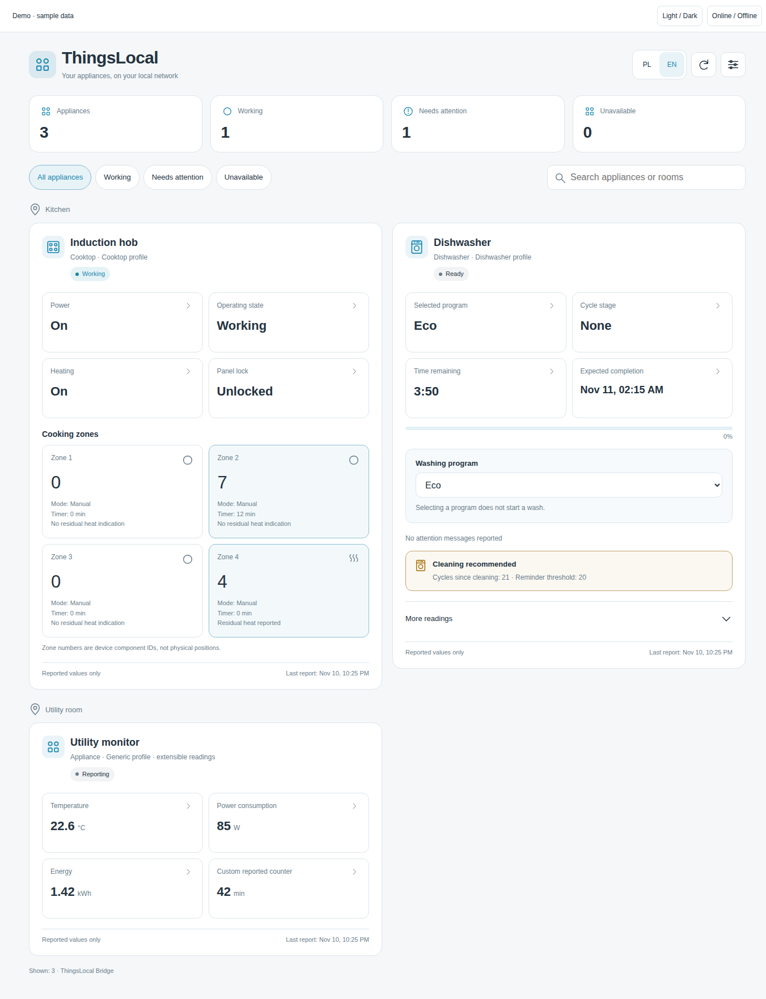

# ThingsLocal Dashboard

**A mobile-friendly Home Assistant dashboard for ThingsLocal Bridge. Polish and
English, automatic device discovery, and your existing HA theme.**

Companion to [ThingsLocal Bridge](https://github.com/jmguzik/thingslocal-bridge),
continued work on **[LocalThings](https://codeberg.org/purplesym/localthings) by
[purplesym (Lars)](https://codeberg.org/purplesym)** and the LocalThings contributors.
See [UPSTREAM.md](UPSTREAM.md) for attribution. The original MQTT implementation
belongs to the bridge; this repository contains its companion UI.

[Polski](README.pl.md)



[Polish phone preview](preview/mobile-pl.png) · [English phone preview, dark theme](preview/mobile-en-dark.png)

## Features

- Discovers multiple ThingsLocal installations/appliances through HA's device and
  entity registries. Device names, model numbers, addresses and entity IDs are not
  compiled into the dashboard. Renamed HA entities remain supported.
- Cooktop cards show reported power, operating state, lock and dynamic cooking
  zone readings. Zone numbers are component IDs, not guessed physical positions.
- Dishwasher cards show reported program, cycle stage, time/progress, messages,
  cleaning reminders and an already-enabled program selector.
- Generic cards preserve readable, unrecognized appliance readings. New hardware
  does not need to match a model-name list. Specialized layouts recognize known
  semantic paths; unknown capabilities/components remain generic.
- PL/EN language switching, locale-aware numbers and dates, light/dark HA themes,
  search, status filters and per-user visibility/diagnostic preferences.
- Single-column phone layout, large touch targets and a responsive layout even
  when the card is embedded in a narrow desktop dashboard column.
- Unknown/unavailable readings stay explicit. A certificate-only diagnostic does
  not establish that an appliance is connected. A cleaning threshold alone does
  not establish that cleaning is needed.

The dashboard uses the current HA session and existing states. It does not
connect directly to Samsung or MQTT, store credentials, create telemetry/history,
or send phone notifications when opened. Notification delivery remains the bridge's
[notification automation](https://github.com/jmguzik/thingslocal-bridge/blob/main/docs/notifications.md).

## Requirements

- Home Assistant **2026.10 or later**.
- ThingsLocal Bridge entities discovered through HA's MQTT integration. Version
  **0.2.0** provides the optional program selector and notification/cleaning data.
  Earlier telemetry-only installations show the fields they provide.
- Your HA account must be allowed to read those entities. Program selection also
  requires HA control permission and the bridge's explicit per-device opt-in.

ThingsLocal Bridge is responsible for appliance onboarding, your domain/TLS
certificate and local DNS. This dashboard adds a UI over its existing HA entities.

## Install

### HACS

1. Add `https://github.com/jmguzik/thingslocal-bridge-dashboard` as a custom
   repository in HACS, category **Integration**.
2. Download **ThingsLocal Dashboard** and restart Home Assistant.
3. Open **Settings → Devices & services → Add integration → ThingsLocal Dashboard**.
4. Open **ThingsLocal** in the sidebar: `/thingslocal-dashboard/overview`.

The first release is experimental. Enable pre-release/beta versions in the
repository's HACS download/version dialog to select **v0.1.0**. See HA's
[pre-release guidance](https://contributors.home-assistant.io/marketplace/guides/releases/#pre-releases).

### Manual installation

Copy `custom_components/thingslocal_dashboard` into HA's `custom_components`
directory and follow steps 2–4 above. The integration registers its bundled card
resource and separate dashboard. A pre-existing dashboard at the same path is
reported as a conflict instead of being overwritten.

For an SSH installation from a local checkout:

```sh
make release
python3 scripts/deploy.py --host YOUR_HA_ADDRESS
```

The installer asks for the SSH password with a hidden prompt; SSH keys and a
password environment variable are also supported. Verify the host's SSH identity
before connecting. It backs up only this integration, runs `ha core check`, restarts
HA and restores previous files if the check/restart fails. Add the integration in
HA after the first installation. No appliance command is sent by installation.

## Language and view settings

The default language follows your HA frontend language: Polish for `pl`, English
for `en` and the fallback. Switch with **PL / EN**, or choose automatic language
under **View settings**. The same settings include visible appliances, compact
readings and diagnostics. Preferences are saved for the current HA user in this
browser/app; they do not synchronize across phones or browsers.

The bundled dashboard is ready to use. To add its card to another dashboard:

```yaml
type: custom:thingslocal-bridge-dashboard
language: auto  # auto, pl, en
read_only: false
```

Optional settings:

```yaml
type: custom:thingslocal-bridge-dashboard
title: My appliances
language: en
read_only: true
device_ids:
  - YOUR_HOME_ASSISTANT_DEVICE_ID
```

`device_ids` contains HA registry device IDs, not serials or IPs. Stored language
preferences take precedence over the YAML default. Refresh devices after adding,
renaming or reassigning devices/entities. Metadata is loaded on opening,
reconnection and manual refresh, not on every state update.

## Controls, permissions and reported messages

Only the actual ThingsLocal **Washing program** select is writable. The dashboard
calls HA's fixed `select.select_option` action with one existing option. It does
not synthesize start, stop, power or arbitrary device commands. Selecting a
program does not start a wash. A service response alone is not confirmation;
the UI waits for a matching reported selection, then times out without retry.

The bridge determines whether the selector is available (powered on, idle, fresh
state). The dashboard additionally checks the HA session, entity control rights,
read-only configuration and pending requests. Read-only mode also hides writable
native-device links; it is a view preference, not a replacement for HA permissions.

The metadata endpoint filters unreadable/disabled/hidden entities before device,
area and count aggregation. It does not return appliance serials, network
addresses or credentials. User/connection changes invalidate cached metadata and
pending UI requests. Offline controls are disabled while last-known readings are
clearly identified.

Message codes are appliance reports, not proof of a currently active fault. The
dashboard shows the bridge's cleaning flag rather than inferring it from a missing
count or a threshold. Missing message data is not labelled as a healthy appliance.

## Preview and checks

The preview uses **synthetic sample data**, including a generic appliance. It
does not contain or contact a household installation.

```sh
make preview
# http://127.0.0.1:8096/preview/?language=en
# http://127.0.0.1:8096/preview/?language=pl&theme=dark
make check
```

Browser checks require an existing Chromium browser and Node.js 22+:

```sh
node scripts/browser-check.mjs /path/to/chromium \
  'http://127.0.0.1:8096/preview/?checks=1&language=pl' \
  360 800 /tmp/thingslocal-browser-profile /tmp/thingslocal-mobile.png
```

Python tests cover discovery, restricted-user metadata and dashboard/resource
ownership. Node/browser tests cover translations, unknown values, controls,
read-only mode, stale-user/reconnect responses and phone layouts. Real appliance
compatibility belongs to ThingsLocal Bridge's documented tested scope.

### Add a language

Add a catalog under `www/locales/` with the same keys and register it in
`www/i18n.js`. The language picker, validation and formatting use that registry.
Add `translations/LANGUAGE.json` to translate the HA integration setup flow too.

## License

AGPL-3.0-or-later. See LICENSE and [UPSTREAM.md](UPSTREAM.md).
